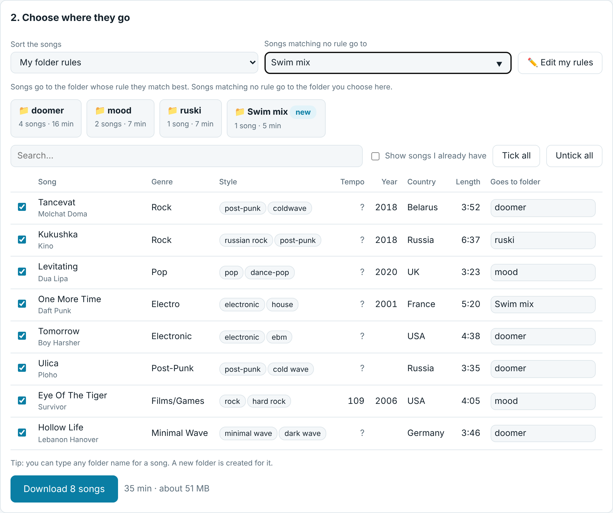
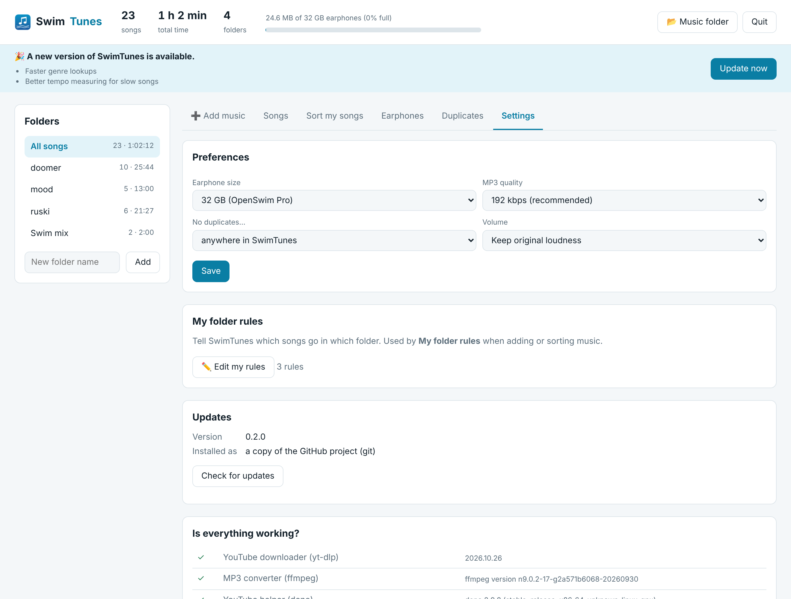
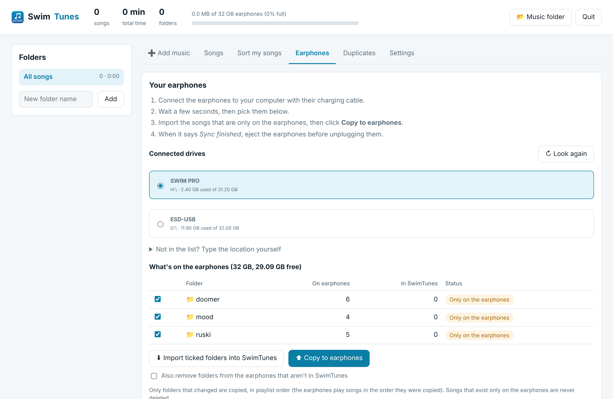
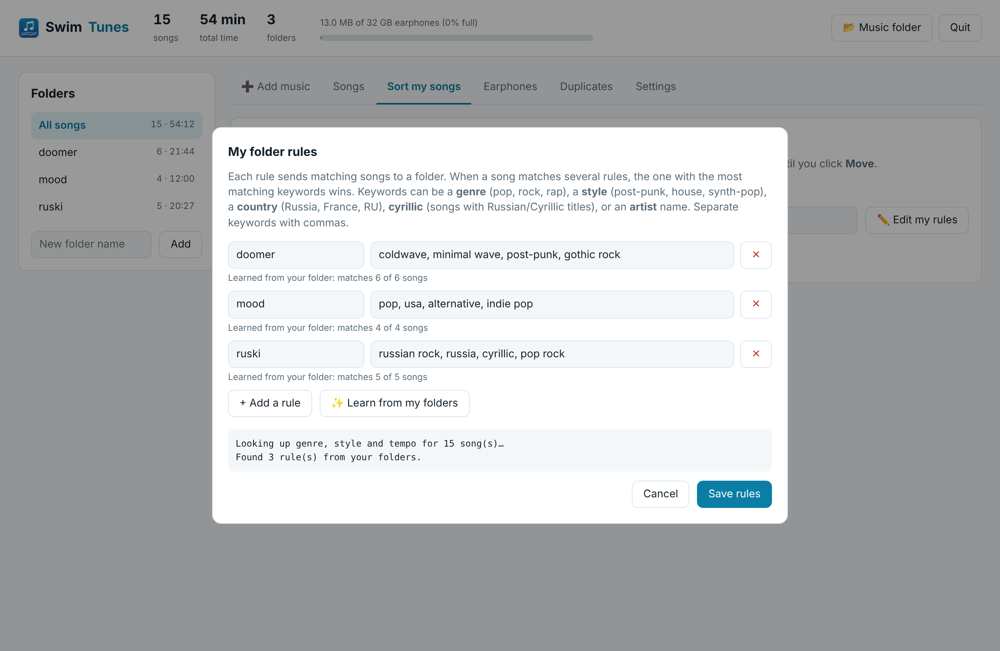
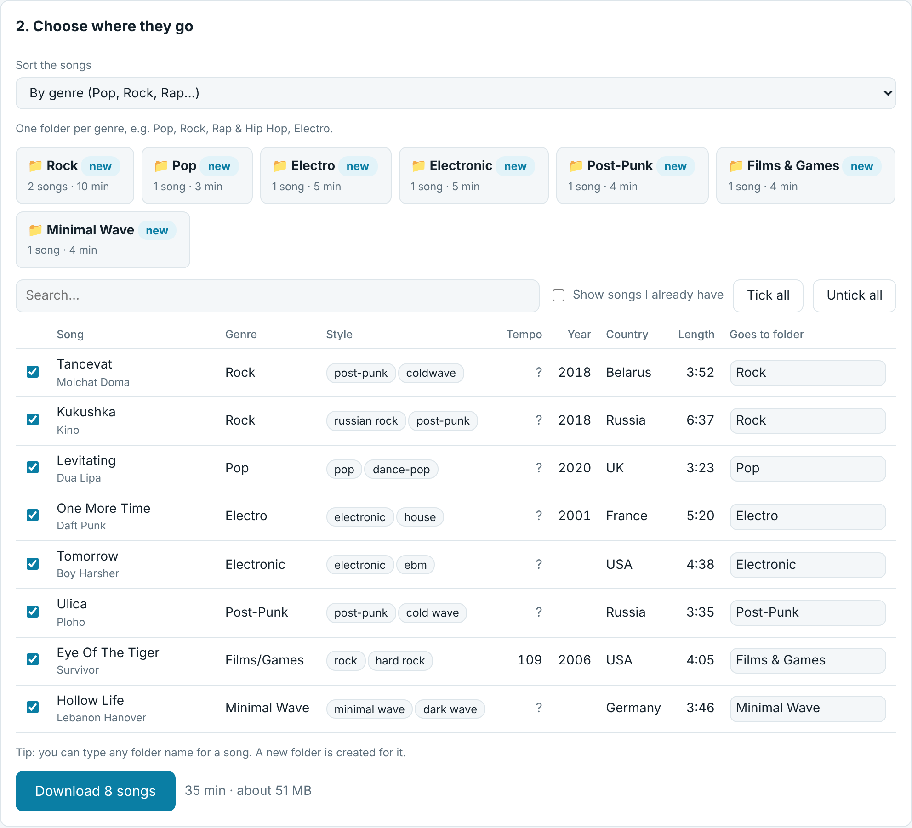
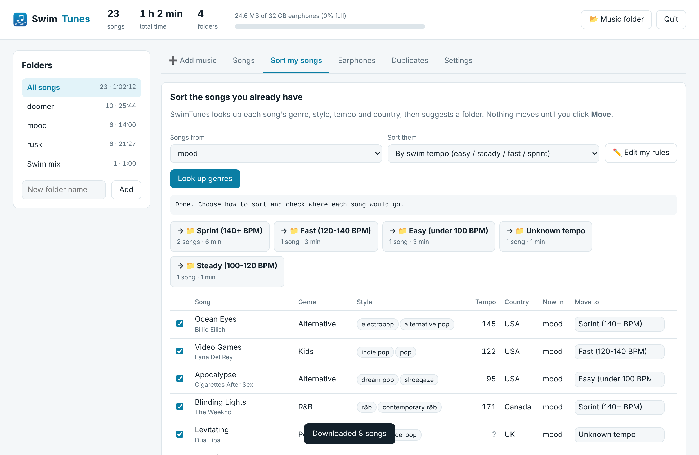
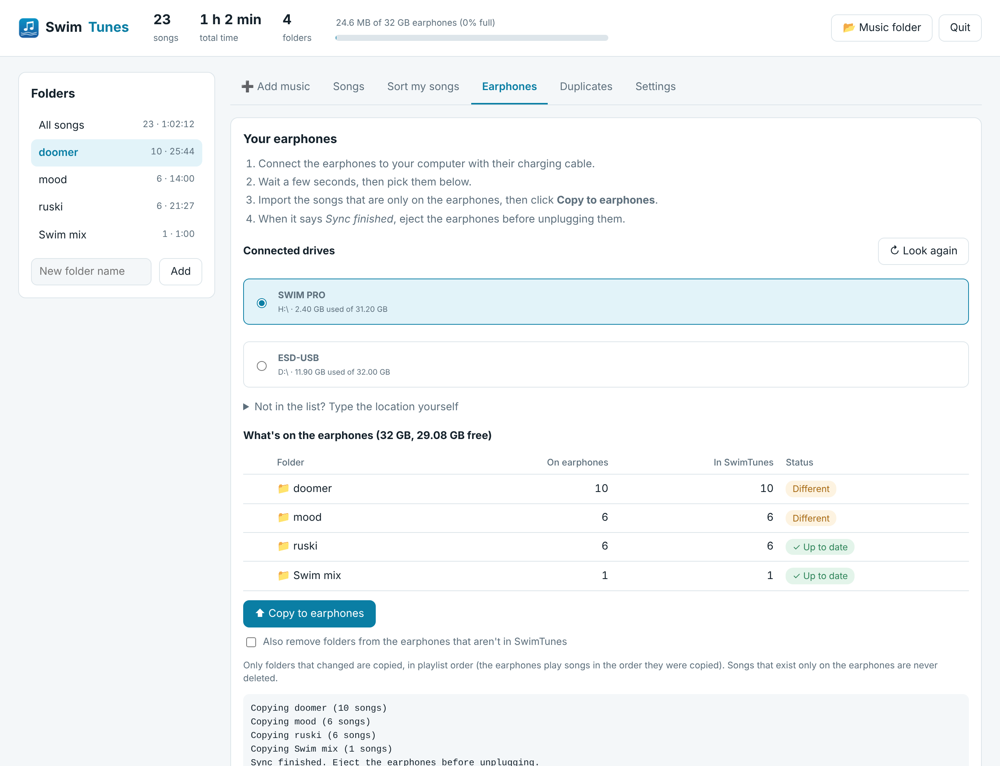
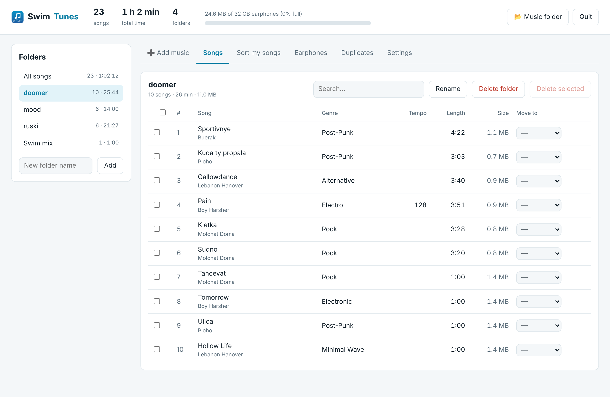
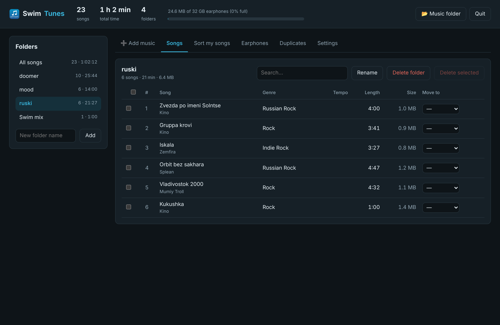
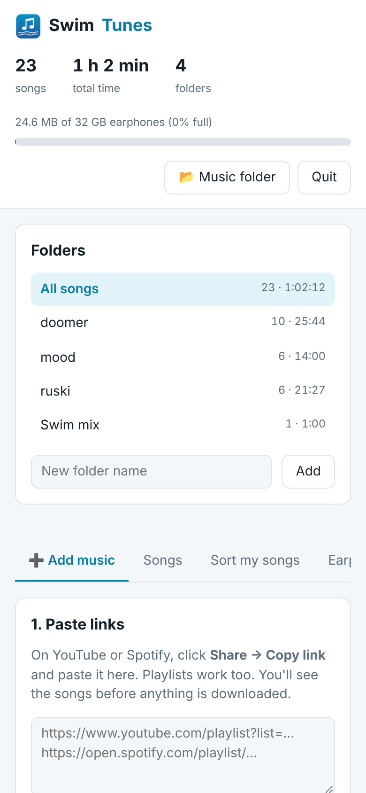

# 🏊 SwimTunes

Put your music on swimming earphones (Shokz OpenSwim, OpenSwim Pro and similar) the easy way.
Paste a **YouTube** or **Spotify** link, see the songs with their **genre, style, tempo and country**,
choose which folder each one goes into, and download them as MP3s. Songs you already have are skipped,
and SwimTunes keeps your earphones in sync, including the folders you made before you had SwimTunes.

Everything happens in a simple page in your web browser. No commands to type.



## Download

| Your computer | Download |
|---|---|
| **Windows** | [SwimTunes-Windows.exe](https://github.com/jumalley/swimtunes/releases/latest/download/SwimTunes-Windows.exe) |
| **Mac** with Apple chip (M1, M2, M3, M4…) | [SwimTunes-Mac-AppleSilicon.zip](https://github.com/jumalley/swimtunes/releases/latest/download/SwimTunes-Mac-AppleSilicon.zip) |
| **Mac** with Intel processor (older Macs) | [SwimTunes-Mac-Intel.zip](https://github.com/jumalley/swimtunes/releases/latest/download/SwimTunes-Mac-Intel.zip) |

Not sure which Mac you have? Click the Apple menu  → **About This Mac**. It says **Chip: Apple M…** or **Processor: Intel**.

Nothing else to install. SwimTunes includes everything it needs.

### First start on Windows

1. Double-click **SwimTunes-Windows.exe**. (Tip: put it in a folder like *Documents\SwimTunes* first.)
2. Windows may say **"Windows protected your PC"**. Click **More info**, then **Run anyway**.
   This only happens the first time, because SwimTunes is a free app that isn't registered with Microsoft.
3. A black window opens, and then SwimTunes opens in your web browser.
   **Leave the black window open** while you use SwimTunes. Close it (or click **Quit**) when you're done.
4. Optional: in **Settings**, click **Put a SwimTunes icon on my desktop**.

### First start on Mac

1. Double-click the downloaded **.zip** file. A **SwimTunes** app appears. Drag it into your **Applications** folder.
2. Double-click **SwimTunes**. The first time, your Mac says it *can't check the app for malicious software*.
   Click **Done** (or **OK**).
3. Open **System Settings → Privacy & Security**, scroll down, and click **Open Anyway** next to
   *"SwimTunes was blocked"*. Enter your password if asked. This only happens the first time.
4. SwimTunes opens in your web browser. To stop it, click **Quit** at the top right of the page.

### Updates

When a new version is out, a banner appears at the top of the page. Click **Update now**:
SwimTunes downloads the new version, restarts, and the page reloads by itself. You can also check
in **Settings → Updates**.



## How to use it

### 1. Bring in the songs already on your earphones

Connect the earphones with their charging cable and open the **Earphones** tab. SwimTunes finds them,
shows each folder on them and whether SwimTunes has it. Click **Import** to copy those songs into SwimTunes,
keeping your folders and their play order. Songs that exist only on the earphones are **never** deleted.



### 2. Let SwimTunes learn how you sort your music

Click **Edit my rules → Learn from my folders**. SwimTunes looks up every song and finds what each of
your folders has in common: a style, a country, Cyrillic titles… You can edit the rules or write your own.



### 3. Add music

In **Add music**, paste YouTube or Spotify links (**Share → Copy link**) and click **Find songs**.
Nothing is downloaded yet: you see every song with its genre, style, tempo, year and the artist's country,
and songs you already have are left out. Then pick how to sort them:

| Sort the songs | Example folders |
|---|---|
| **My folder rules** | doomer, mood, ruski… (the best-matching rule wins) |
| **By genre** | Pop, Rock, Rap & Hip Hop, Electro |
| **By style** | Post-Punk, House, Synth-Pop, Coldwave |
| **By swim tempo** | Easy (under 100 BPM), Steady, Fast, Sprint (140+ BPM) |
| **By decade** | 1980s, 1990s, 2000s |
| **By artist's country** | Russia, France, USA |
| **By artist** | one folder per artist |
| **All in one folder** | the playlist's name, or any folder you type |

You can change the folder of any song, untick songs you don't want, then click **Download**.



Tempo comes from Deezer when it knows it. Otherwise SwimTunes measures it from the audio after downloading.

### 4. Sort the songs you already have

**Sort my songs** uses the same sorting options on songs that are already in SwimTunes. It shows where
each song would go, and nothing moves until you click **Move**.



### 5. Copy to your earphones

Back in **Earphones**, click **Copy to earphones**. Only folders that changed are copied, in playlist order
(the earphones play songs in the order they were copied). When it says *Sync finished*, eject the earphones.



### Also

- **Songs**: every folder with its songs, genre, tempo, length and size. Rename, delete, move songs, search.
- **Duplicates**: finds doubles already in your folders ("Official Video", "Lyrics", "feat."… are ignored).
- **Settings**: earphone size (filled in automatically from your earphones), MP3 quality, even out the volume, health check.
- Dark mode and small screens are supported.



<p> </p>

> Screenshots use sample data: the songs are silent demo files and downloads are simulated,
> but genre, style and country come from the real Deezer and MusicBrainz databases.

## Questions

**Where are my MP3s?** In the **Music** folder of your computer, inside **SwimTunes**. Click **📂 Music folder** at the top of the page.

**Downloads stopped working.** YouTube changes things now and then. Update SwimTunes (banner at the top, or
Settings → Updates). New versions are built automatically every month.

**Where does the genre information come from?** From [Deezer](https://www.deezer.com) (genre, tempo, year) and
[MusicBrainz](https://musicbrainz.org) (styles, country). Both are free and need no account. Lookups are saved,
so each song is looked up only once.

**My Spotify playlist only shows about 100 songs.** Spotify only shows the first ~100 songs to apps like this.
For longer playlists, convert the playlist to YouTube with [playlistbuddy.com](https://playlistbuddy.com) and paste the YouTube playlist link instead.

**It says the earphones aren't found.** Connect them to the computer with the charging cable (not to a wall plug),
wait 10 seconds and click **Look again**. On Windows they appear in **This PC** (e.g. *SWIM PRO (H:)*).

**Is this allowed?** Only download music you're allowed to: your own uploads, free music, or what the law where you live allows for personal use.

---

## For developers

### Running from source

```bash
git clone https://github.com/jumalley/swimtunes.git
cd swimtunes
pip install -e .
python -m swimtunes ui
```

A copy made with `git clone` updates itself from the dashboard too (it runs `git pull`, installs new
requirements if needed and restarts). ffmpeg and Deno (needed for YouTube) are installed from PyPI.

### Command line

Everything is in the dashboard, but a command line exists for scripting:

```bash
swimtunes download "https://www.youtube.com/playlist?list=..." -f "Morning Swim"
swimtunes stats [FOLDER]          # folders / songs with length and size
swimtunes dupes [--fix]           # list duplicates / move extra copies to the trash
swimtunes sync H:\                # copy to the earphones (never deletes songs only on them)
swimtunes doctor                  # check ffmpeg, deno and yt-dlp
```

Use `python -m swimtunes ...` if the `swimtunes` command isn't found. The music folder is `~/Music/SwimTunes`
(change it with `--library` or the `SWIMTUNES_LIBRARY` environment variable).

### How it's organized

| file | what it does |
|---|---|
| `swimtunes/downloader.py` | find songs behind a link (yt-dlp, Spotify embed page), download + convert to MP3 |
| `swimtunes/meta.py` | genre/tempo/year (Deezer), styles/country (MusicBrainz), tempo measurement |
| `swimtunes/sorter.py` | sorting modes, folder rules, learning rules from existing folders |
| `swimtunes/library.py` | the music folder: tags, stats, duplicates, trash |
| `swimtunes/device.py` | find the earphones, compare, import, sync in play order |
| `swimtunes/updater.py` | in-app updates (release download or git pull) |
| `swimtunes/web.py`, `templates/index.html` | the dashboard |

### How the apps are built

[`.github/workflows/build-apps.yml`](.github/workflows/build-apps.yml) runs the tests, builds the
Windows and Mac apps with PyInstaller ([`packaging/swimtunes.spec`](packaging/swimtunes.spec)), checks
each one with `doctor`, and publishes them as a GitHub release. It runs on every code change and once a month,
so the apps always include a recent yt-dlp.

### Tests

```bash
pip install -e ".[test]" && pytest
```
