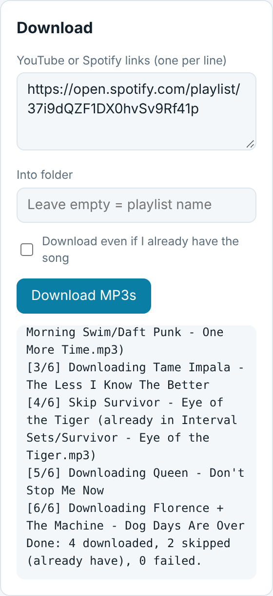
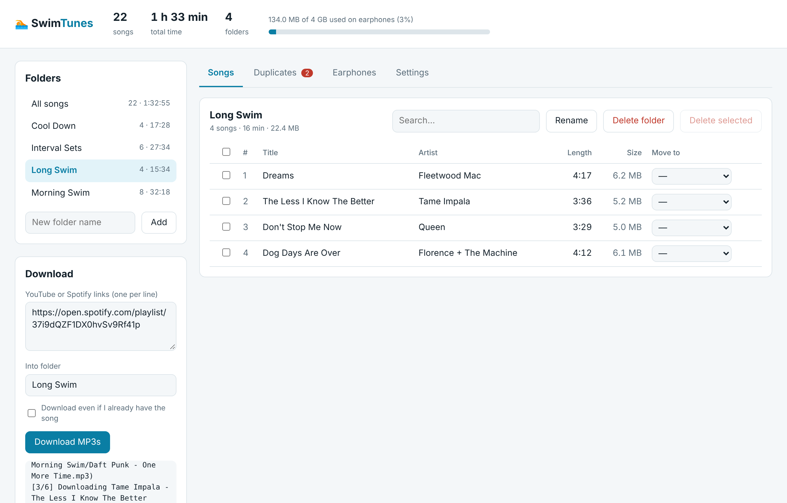
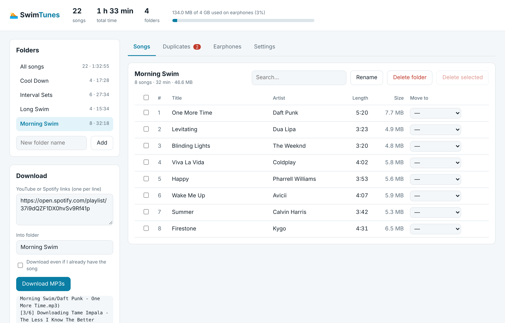
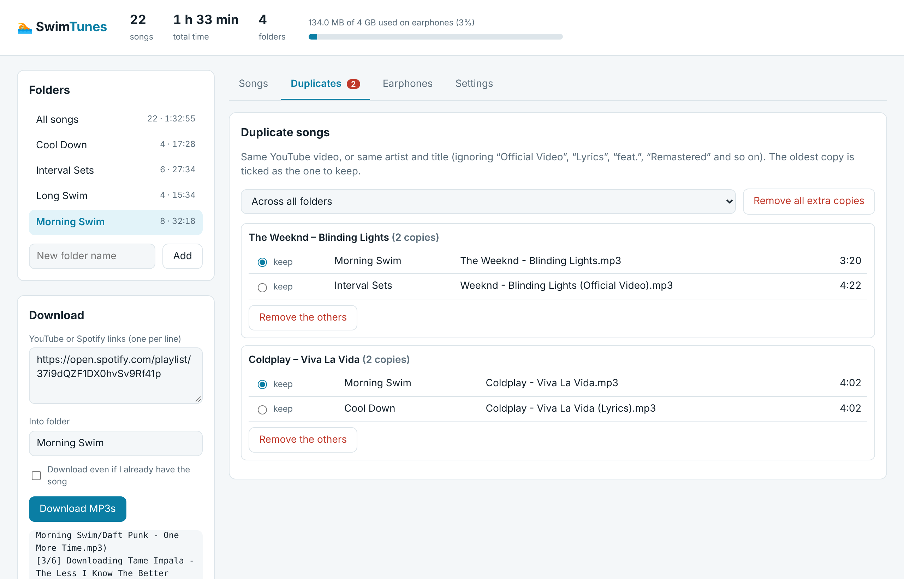
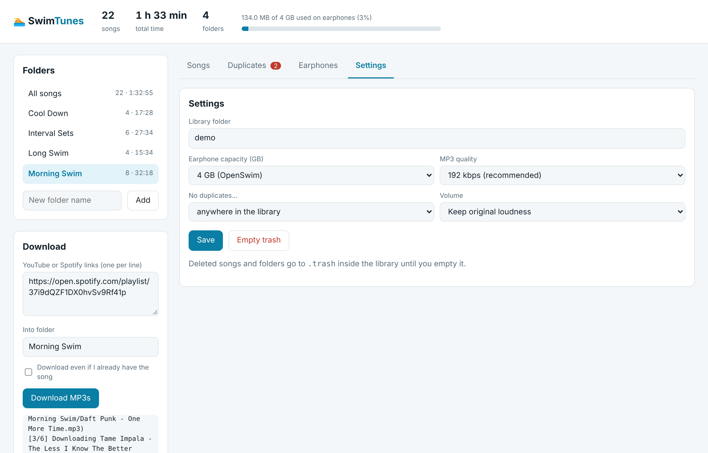
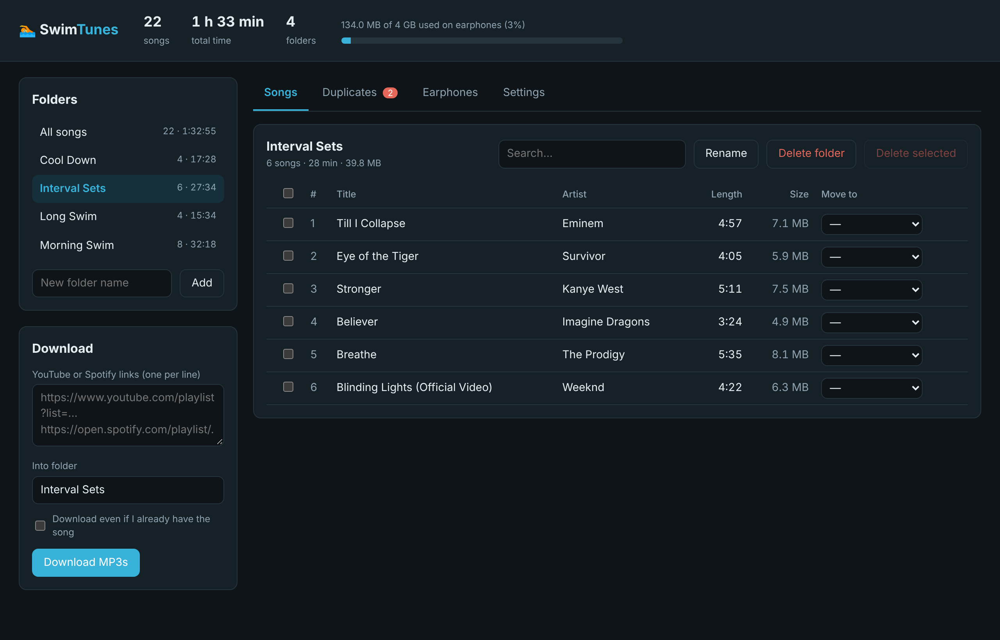
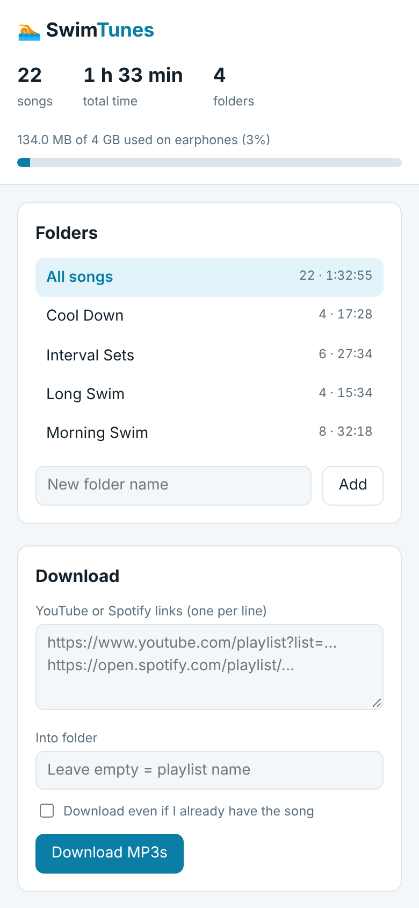

# 🏊 SwimTunes

Download music as MP3 for swimming earphones (Shokz OpenSwim and similar), with
**no duplicate songs**, and manage your folders from a simple dashboard.

- **YouTube links**: a single video or a whole playlist → MP3 (same as notube, but local and in bulk)
- **Spotify links**: playlist, album or track. Each song is found on YouTube automatically,
  picking the studio version (it avoids live, cover, remix and sped-up uploads and matches the song length)
- **No doubles**: before downloading, every song is checked against your whole library
  (same video, or same artist + title, ignoring "Official Video", "Lyrics", "feat.", "Remastered" and so on)
- **Folder dashboard**: song count, total length and size per folder, how full the earphones are,
  move/delete songs, rename/delete folders, and a duplicates finder
- **Sync to earphones**: copies folders in playlist order (OpenSwim plays files in the order they
  were *copied*, not A–Z) and removes the Mac `._` junk files the earphones try to play

## How it works

> These screenshots use a sample library: the songs are silent demo files and the
> download is simulated. Your real library looks the same.

**1. Your library at a glance:** every folder with song count and total length, and how full the earphones are.


**2. Paste a YouTube or Spotify link and download.** Songs you already have are skipped automatically
(here, *One More Time* and *Eye of the Tiger* were already in other folders).



**3. The new folder is ready:** titles, artists, length and size for every song.



**4. Manage a folder:** search, rename, delete, or move songs to another folder.



**5. Find duplicates** that are already in your folders. Pick which copy to keep and remove the rest.



**6. Copy to the earphones:** only changed folders are copied, in playlist order.


**7. Settings:** earphone size, MP3 quality, duplicate rule and volume levelling.



It follows your system's dark mode and works on a phone screen too:

<p> </p>

### Command line output

```text
$ swimtunes stats
Folder         Songs   Length      Size
-------------  -----  -------  --------
Cool Down          4    17:28   24.0 MB
Interval Sets      6    27:34   37.9 MB
Long Swim          4    15:34   21.4 MB
Morning Swim       8    32:18   44.4 MB
TOTAL             22  1:32:55  127.8 MB

Earphones: 127.8 MB of 4 GB (3% full)
⚠ 2 duplicate song(s). Run `swimtunes dupes` to see them.

$ swimtunes dupes
The Weeknd - Blinding Lights
   keep    Morning Swim/The Weeknd - Blinding Lights.mp3
   extra   Interval Sets/Weeknd - Blinding Lights (Official Video).mp3
Coldplay - Viva La Vida
   keep    Morning Swim/Coldplay - Viva La Vida.mp3
   extra   Cool Down/Coldplay - Viva La Vida (Lyrics).mp3
```

## Install (once)

You need **Python 3.10+** and **ffmpeg**.

| | |
|---|---|
| macOS | `brew install python ffmpeg` |
| Windows | `winget install Python.Python.3.12 Gyan.FFmpeg` (then open a new terminal) |
| Linux | `sudo apt install python3-pip ffmpeg` |

Then, in this folder:

```bash
pip install -e .
```

## Use it

### The dashboard (easiest)

```bash
swimtunes ui
```

This opens http://localhost:8765. Paste links into **Download**, pick a folder (or leave it empty to
use the playlist's name), and click **Download MP3s**. The **Earphones** tab copies everything onto the
earphones. Your music goes in `~/Music/SwimTunes` (change it with `--library` or the
`SWIMTUNES_LIBRARY` environment variable).

### Command line

```bash
swimtunes download "https://www.youtube.com/playlist?list=..." -f "Morning Swim"
swimtunes download "https://open.spotify.com/playlist/..."          # folder = playlist name
swimtunes stats                     # every folder: songs, length, size, % of earphones used
swimtunes stats "Morning Swim"      # songs in one folder
swimtunes dupes                     # list duplicates
swimtunes dupes --fix               # keep the oldest copy, move the rest to the trash
swimtunes folder rename "Morning Swim" "Warm Up"
swimtunes move "Warm Up/Coldplay - Yellow.mp3" "Cool Down"
swimtunes sync /Volumes/SWIM        # Mac;  on Windows e.g.  swimtunes sync E:\
swimtunes config capacity_gb 32     # OpenSwim Pro
swimtunes config normalize true     # even out loudness between songs
```

Deleted songs and folders go to `.trash` inside the library until you run `swimtunes empty-trash`.

## Settings

| setting | default | |
|---|---|---|
| `capacity_gb` | 4 | 4 = OpenSwim, 32 = OpenSwim Pro |
| `bitrate` | 192 | 128 / 192 / 256 / 320 kbps. 192 fits about 1,400 songs in 4 GB |
| `normalize` | false | make all songs about equally loud |
| `dupe_scope` | library | `library` = never the same song twice anywhere; `folder` = only within a folder |

## Notes

- **Big Spotify playlists**: the Spotify reader uses the public embed page (no account
  needed), which may stop at about 100 songs. For longer playlists, convert them with
  [playlistbuddy](https://playlistbuddy.com) and paste the resulting **YouTube playlist** link. That works too,
  and duplicates are still skipped.
- The playlist must be **public**.
- If YouTube downloads start failing, update yt-dlp: `pip install -U yt-dlp`.
- Only download music you're allowed to: your own uploads, free/CC music, or what your local law
  permits for personal use.

## Tests

```bash
pip install pytest && pytest
```
