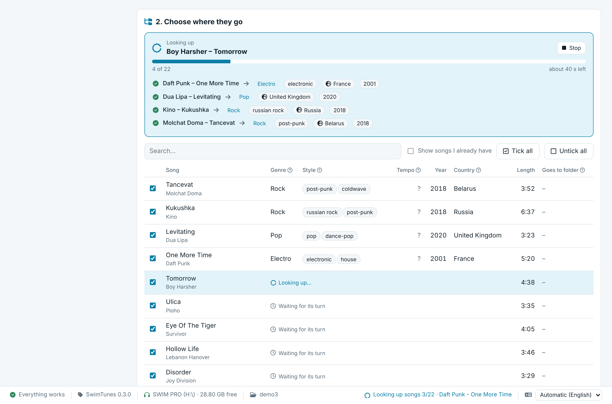
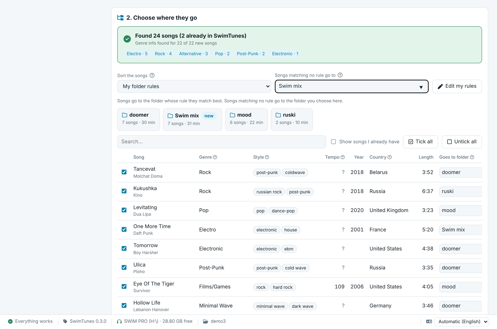
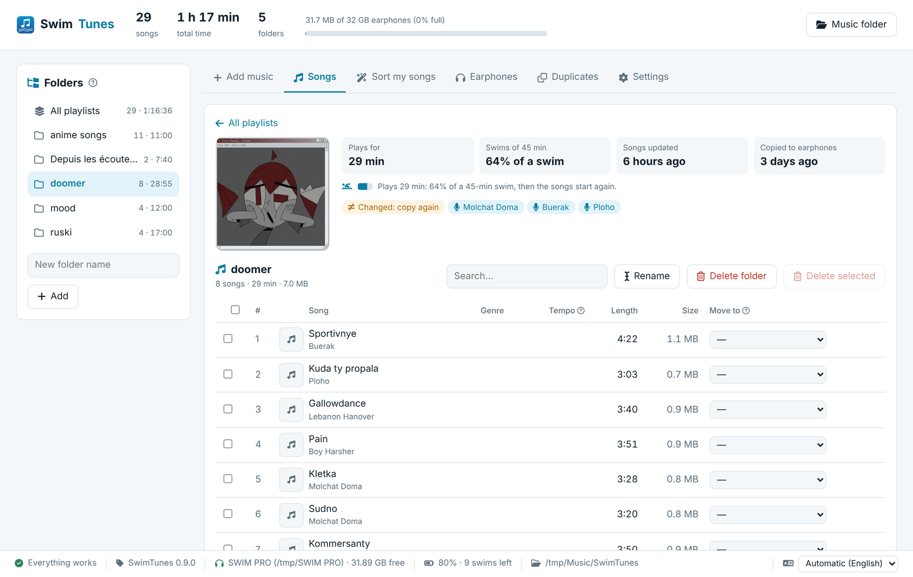
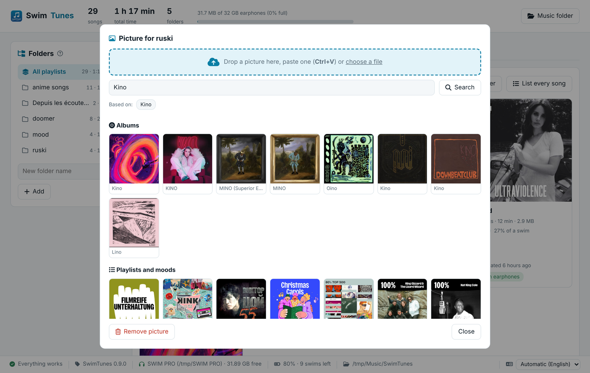
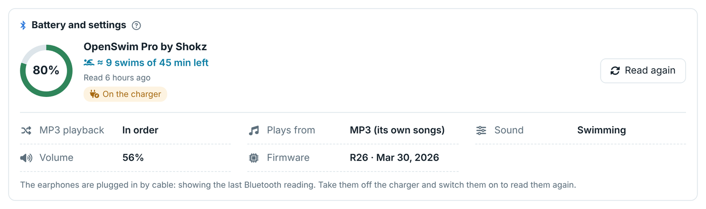
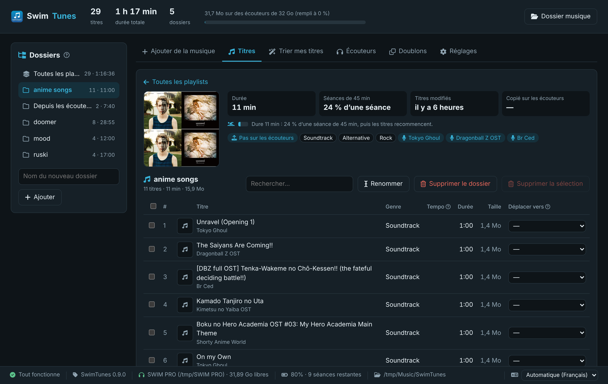
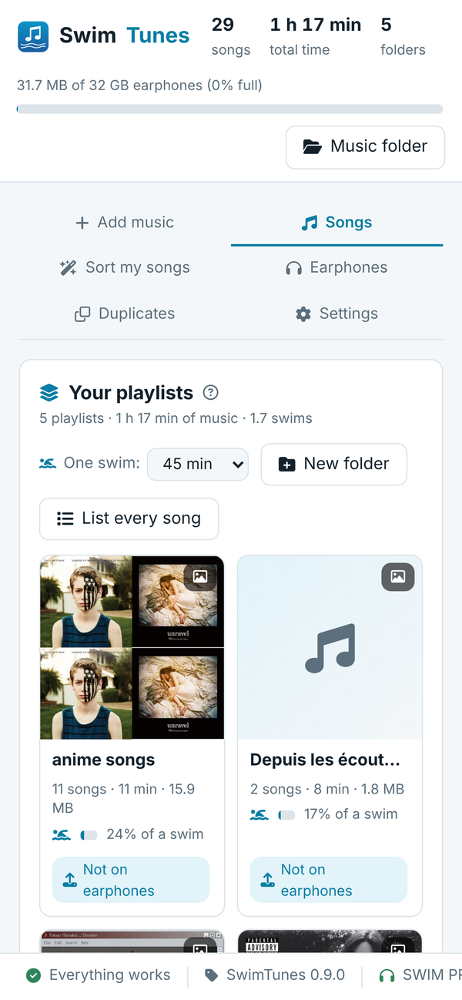

# SwimTunes

**Music for your swimming earphones, without the hassle.** Paste a YouTube or Spotify link, and SwimTunes
downloads the songs as MP3, sorts them into playlists by genre, tempo or your own rules, skips songs you
already have, and copies everything to your Shokz OpenSwim earphones in the right order.

- **YouTube and Spotify links**: videos, playlists, albums, your private playlists and Liked Songs.
- **No duplicates**: a song you already have is never downloaded or copied twice.
- **Playlists you can see**: pictures, how long each one plays *in swims*, when it changed, whether the earphones are up to date.
- **Sorted for you**: by genre, style, tempo (BPM), decade, country, artist, or rules it learns from your folders.
- **Earphones**: copies in playlist order, imports the songs already on them, shows battery and firmware over Bluetooth.
- **Simple**: everything happens in a web page, in English, French, Spanish, German, Italian or Portuguese. It updates itself.

## Download

| Your computer | Download |
|---|---|
| **Windows** | [**SwimTunes-Setup.exe**](https://github.com/jumalley/swimtunes/releases/latest/download/SwimTunes-Setup.exe) |
| **Mac** with Apple chip (M1, M2, M3…) | [**SwimTunes-Mac-AppleSilicon.dmg**](https://github.com/jumalley/swimtunes/releases/latest/download/SwimTunes-Mac-AppleSilicon.dmg) |
| **Mac** with Intel processor | [**SwimTunes-Mac-Intel.dmg**](https://github.com/jumalley/swimtunes/releases/latest/download/SwimTunes-Mac-Intel.dmg) |

Nothing else to install. (Which Mac? Apple menu  → **About This Mac**: *Chip: Apple M…* or *Processor: Intel*.)

<b>Windows</b>: install steps

1. Double-click **SwimTunes-Setup.exe**. If Windows says *"Windows protected your PC"*, click **More info** → **Run anyway**
   (SwimTunes is free and not registered with Microsoft; this happens once).
2. Click **Install**. No administrator password needed. SwimTunes opens in your web browser.
3. From then on, open it from the **Start menu** or the **desktop icon**. While it runs, a SwimTunes icon sits next to
   the clock: click it to open SwimTunes, right-click → **Quit** to stop it.

To remove it: **Settings → Apps → SwimTunes → Uninstall**. Your music stays in *Music\SwimTunes*.

<b>Windows blocks it</b> ("Smart App Control blocked a potentially dangerous app")?

Some Windows 11 PCs only run apps signed by a known company. Use the Python version instead; it's just as simple:

1. Install **Python** from [python.org/downloads](https://www.python.org/downloads/) (yellow button → **Install Now**).
2. Download [**SwimTunes.pyw**](https://github.com/jumalley/swimtunes/releases/latest/download/SwimTunes.pyw), put it on
   your desktop (if your browser asks, choose **Keep**).
3. Double-click it. The first time it sets itself up (about a minute), then SwimTunes opens in your browser.
   Each time after, it checks for a new version first.

<b>Mac</b>: install steps

1. Open the **.dmg** and drag **SwimTunes** onto **Applications**.
2. Open SwimTunes. The first time, macOS says it *can't check the app*: click **Done**, then open
   **System Settings → Privacy & Security** and click **Open Anyway** next to *"SwimTunes was blocked"*. This happens once.
3. SwimTunes opens in your browser. To stop it, click **Quit** at the top right of the page.

**Updates are automatic**: when SwimTunes starts and a new version exists, it installs it and restarts (about a
minute). You can turn this off in **Settings → Updates**, choose to get **test versions first**, or **go back** to the
previous version.

## How it works

**1. Bring in what's already on your earphones.** Plug them in with the charging cable and open **Earphones**.
SwimTunes shows each folder and whether it's up to date, and imports the songs that are only on the earphones.

**2. Add music.** On YouTube or Spotify, click **Share → Copy link**, paste it in **Add music** and click **Find songs**.
You see each song as it's looked up (genre, style, tempo, country), and the ones you already have are skipped.

**3. Choose the folders.** Put everything in one folder, or sort by genre, style, tempo, decade, country, artist,
or **your own rules** ("post-punk, coldwave → doomer"). SwimTunes can learn rules from the folders you already have.
Then click **Download**. Songs download three at a time and appear in your playlists right away.

**4. Copy to your earphones.** In **Earphones**, click **Copy to earphones**. Only folders that changed are copied,
in playlist order (the earphones play songs in the order they were copied). Then click **Eject** and unplug them.

### Your playlists

**Songs** shows one card per folder, exactly like on the earphones: its picture, how long it plays, how many swims it
lasts (choose how long one swim is), when songs were last added or removed, and whether the earphones have the latest
version. Click **Add picture** to drop your own, use an album cover, make a mosaic, or pick one suggested from the songs.

### Battery, firmware and settings

In **Earphones → Battery and settings**, click **Read from the earphones** to see the battery (and how many swims are left),
the firmware, MP3 or Bluetooth mode, sound mode and volume. If they're on **shuffle** (your playlist order is then ignored),
**Play in order** switches it back. This uses the same Bluetooth protocol as the free
[Gadgetbridge](https://gadgetbridge.org/gadgets/headphones/shokz/) app. Pair the earphones with your computer once, switch them on
and take them off the charger. Works on Windows and Linux.

### From your phone

Nothing to install on the phone. In **Settings → Use from my phone**, tick *Let my phone open SwimTunes*: a QR code and
a 6-digit code appear. On the same Wi-Fi, scan the QR code with the phone's camera, type the code once, and SwimTunes
opens in the phone's browser (add it to the home screen to open it like an app). Paste links from the YouTube or
Spotify app, follow playlists, copy to the earphones plugged into the computer.

The computer does the work, so it has to stay on with SwimTunes running. Only devices that typed the code can use it,
only on your home network, and quitting or changing these settings is only possible on the computer.

### Followed playlists

Tick **Follow this playlist** before downloading a playlist. Each time SwimTunes starts (at most every 6 hours),
it looks for new songs in it and downloads them into the same folder; or untick *Download automatically* to just see
"3 new songs" and get them with one click. Followed playlists are listed in **Add music**.

### Private playlists

In **Settings → Accounts**, connect **YouTube** (through Firefox, or a cookies.txt file) and **Spotify** (a free
"Client ID", about 2 minutes, steps on the page). Then **My playlists** next to *Find songs* lists your own playlists,
private ones and Liked Songs included. Your logins stay on your computer.

### Everywhere

Every option has a **?** that explains it, and the bar at the bottom shows whether everything works, your earphones
and their battery, and what SwimTunes is doing. It works on a phone-sized window and in dark mode.

> Screenshots use sample songs; downloads and the Bluetooth reading are simulated. Genres and picture suggestions
> come from the real Deezer and MusicBrainz databases.

## Questions

<b>Where are my MP3s?</b>

In your **Music** folder, inside **SwimTunes**. Click **Music folder** at the top of the page.

<b>Downloads stopped working, or some failed.</b>

Hover the red label to see why. YouTube changes things now and then: SwimTunes updates itself, and new versions are
built every month. When YouTube refuses a download, SwimTunes already tries other ways; click **Retry failed songs**
a bit later. Age-restricted or region-blocked videos can't be downloaded: try another upload of the same song.

<b>YouTube refuses almost every download ("Sign in to confirm you're not a bot").</b>

YouTube sometimes asks for a "proof of origin" token, like a normal browser sends. Turn on
**Settings → YouTube token helper (advanced)**: SwimTunes downloads the free, open-source
[bgutil](https://github.com/Brainicism/bgutil-ytdlp-pot-provider) helper onto your computer (about 230 MB, checked
against known fingerprints) and uses it for downloads. It isn't part of SwimTunes (it's GPL-licensed), and you can
remove it in the same place.

<b>A warning about my YouTube login ("Could not copy Chrome cookie database").</b>

Chrome and Edge lock their login while open and, on Windows, don't share it with other apps. SwimTunes then downloads
without it (public songs work). To use your login, choose **Firefox** or a **cookies.txt** file in Settings → Accounts.

<b>A song has wrong or missing genre info.</b>

Genre, tempo and year come from [Deezer](https://www.deezer.com), styles and country from [MusicBrainz](https://musicbrainz.org)
(free, no account). They don't know every song; SwimTunes then guesses from the title and YouTube tags (soundtrack,
anime, nightcore, lo-fi…). Click the **pencil** next to a song to correct its artist or title and look it up again.

<b>My Spotify playlist shows only about 100 songs, or none.</b>

Without a connected account, Spotify shows only the first ~100 songs: connect your account (Settings → Accounts) to get
them all. Some playlists (other people's, Spotify's own charts) can't be read through an account; SwimTunes then reads the
public page instead.

<b>"Already there" or "Unavailable on YouTube".</b>

*Already there*: you already have this song (the tooltip says where), so it isn't downloaded twice.
*Unavailable*: the video is private or deleted; it's skipped.

<b>The earphones aren't found.</b>

Connect them to the computer with the charging cable (not a wall plug), wait 10 seconds and click **Look again**.
On Windows they appear in **This PC** (e.g. *SWIM PRO (H:)*). Still missing? Open *Not in the list?* and type their location.

<b>Bluetooth: "Couldn't connect", or why not through the cable?</b>

On the charger the earphones are only a USB drive and send no battery or settings: those come over Bluetooth only
(like in the Shokz app). Pair them once in your computer's Bluetooth settings, switch them on, take them off the charger,
keep them close. If your phone is connected to them, turning its Bluetooth off for a moment can help.

<b>Songs play in the wrong order.</b>

The earphones may be on shuffle: **Earphones → Battery and settings** shows it, and **Play in order** switches it back.

<b>Is there a phone app?</b>

No need: SwimTunes on your computer can be used from your phone's browser (Settings → Use from my phone). A computer is
needed anyway: it downloads and converts the songs, and the earphones receive them through their USB cable.

<b>Something doesn't work: how do I report it?</b>

**Settings → Other → Copy a problem report**, then paste it in your message (or a
[GitHub issue](https://github.com/jumalley/swimtunes/issues)). It contains your version, the health checks, recent
errors and the end of the logs; no logins, no Bluetooth address, and your user folder is replaced by `~`.

<b>Is this allowed?</b>

Only download music you're allowed to: your own uploads, free music, or what the law where you live allows for personal use.

## For developers

Run from source, the command line, how the code is organized, tests and releases:
[docs/DEVELOPMENT.md](docs/DEVELOPMENT.md).

SwimTunes is free and open source under the [MIT license](LICENSE).
Icons: [Font Awesome Free](https://fontawesome.com) (CC BY 4.0 / SIL OFL / MIT). Bluetooth protocol:
[Gadgetbridge](https://codeberg.org/Freeyourgadget/Gadgetbridge) (AGPL; SwimTunes reimplements the message format, no code is copied).
