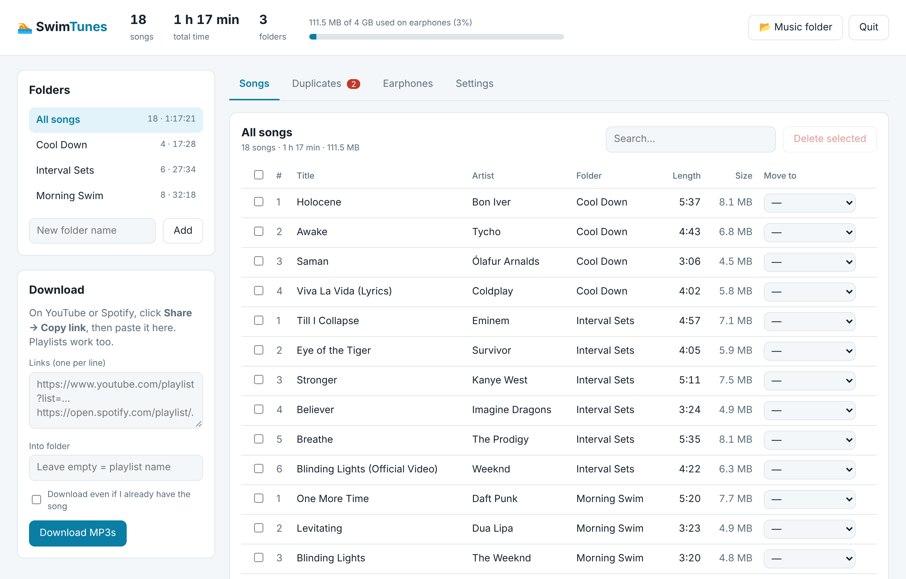
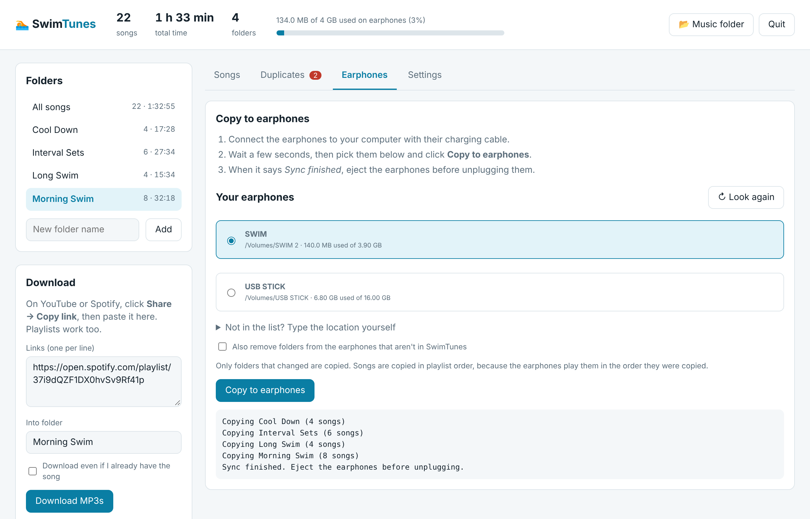

# 🏊 SwimTunes

Put your music on swimming earphones (Shokz OpenSwim and similar) the easy way.
Paste a **YouTube** or **Spotify** link, and SwimTunes downloads the songs as MP3s,
**skips songs you already have**, and copies them onto your earphones.



## Download

| Your computer | Download |
|---|---|
| **Windows** | [SwimTunes-Windows.exe](https://github.com/jumalley/swimtunes/releases/latest/download/SwimTunes-Windows.exe) |
| **Mac** with Apple chip (M1, M2, M3, M4…) | [SwimTunes-Mac-AppleSilicon.zip](https://github.com/jumalley/swimtunes/releases/latest/download/SwimTunes-Mac-AppleSilicon.zip) |
| **Mac** with Intel processor (older Macs) | [SwimTunes-Mac-Intel.zip](https://github.com/jumalley/swimtunes/releases/latest/download/SwimTunes-Mac-Intel.zip) |

Not sure which Mac you have? Click the Apple menu  → **About This Mac**. It says **Chip: Apple M…** or **Processor: Intel**.

Nothing else to install. SwimTunes includes everything it needs.

### First start on Windows

1. Double-click **SwimTunes-Windows.exe**. (Tip: move it to your Desktop first.)
2. Windows may say **"Windows protected your PC"**. Click **More info**, then **Run anyway**.
   This only happens the first time, because SwimTunes is a free app that isn't registered with Microsoft.
3. A black window opens, and then SwimTunes opens in your web browser.
   **Leave the black window open** while you use SwimTunes. Close it when you're done.

### First start on Mac

1. Double-click the downloaded **.zip** file. A **SwimTunes** app appears. Drag it into your **Applications** folder.
2. Double-click **SwimTunes**. The first time, your Mac says it *can't check the app for malicious software*.
   Click **Done** (or **OK**).
3. Open **System Settings → Privacy & Security**, scroll down, and click **Open Anyway** next to
   *"SwimTunes was blocked"*. Enter your password if asked.
   This only happens the first time, because SwimTunes is a free app that isn't registered with Apple.
4. SwimTunes opens in your web browser. To stop it, click **Quit** at the top right of the page.

After the first time, just double-click SwimTunes like any other app.

## How to use it

**1. Download music.** On YouTube or Spotify, click **Share → Copy link**, paste the link into **Download**,
and click **Download MP3s**. Whole playlists work. Songs you already have are skipped automatically.


**2. Check your folders.** Each playlist gets its own folder. You see how many songs it has, how long it lasts,
and how full your earphones will be. You can rename folders, move songs, or delete them.


**3. Copy to your earphones.** Connect the earphones with their charging cable, open the **Earphones** tab,
pick them, and click **Copy to earphones**. When it says *Sync finished*, eject them before unplugging.



### Duplicates

SwimTunes won't download a song you already have, even if it's a different video of it
("Official Video", "Lyrics", "Remastered", "feat." and so on are ignored). The **Duplicates** tab
finds doubles that are already in your folders. Pick the copy to keep and remove the rest.


### Settings

Choose your earphones' size (4 GB OpenSwim or 32 GB OpenSwim Pro), the sound quality,
and whether all songs should play at the same volume.


It also has a dark mode and works on small screens:

<p> </p>

> The screenshots use a sample library: the songs are silent demo files and the download is simulated.

## Questions

**Where are my MP3s?** In the **Music** folder of your computer, inside **SwimTunes**. Click **📂 Music folder** at the top of the page to open it.

**Downloads stopped working.** YouTube changes things now and then. When a new version of SwimTunes is out,
a banner at the top of the page tells you. Download the new version and replace the old app with it.
New versions are built automatically every month.

**My Spotify playlist only downloaded about 100 songs.** Spotify only shows the first ~100 songs to apps like this.
For longer playlists, convert the playlist to YouTube with [playlistbuddy.com](https://playlistbuddy.com) and paste the YouTube playlist link instead.

**It says the earphones aren't found.** Make sure they're connected with the charging cable to the computer (not to a wall plug),
wait 10 seconds and click **Look again**. On a Mac they also appear in Finder's sidebar; on Windows, in **This PC**.

**Is this allowed?** Only download music you're allowed to: your own uploads, free music, or what the law where you live allows for personal use.

---

## For developers

Everything in the app is also available from Python, as a command line tool.

```bash
pip install -e .
swimtunes ui                      # the dashboard (same as the app)
swimtunes download "https://www.youtube.com/playlist?list=..." -f "Morning Swim"
swimtunes download "https://open.spotify.com/playlist/..."      # folder = playlist name
swimtunes stats                   # folders with song count, length, size
swimtunes stats "Morning Swim"    # songs in one folder
swimtunes dupes [--fix]           # list duplicates / move extra copies to the trash
swimtunes folder rename "Morning Swim" "Warm Up"
swimtunes move "Warm Up/Coldplay - Yellow.mp3" "Cool Down"
swimtunes sync /Volumes/SWIM      # or E:\ on Windows
swimtunes config capacity_gb 32
swimtunes doctor                  # check ffmpeg, deno and yt-dlp
```

If the `swimtunes` command isn't found, use `python -m swimtunes ...` instead.
The music folder is `~/Music/SwimTunes`; change it with `--library` or the `SWIMTUNES_LIBRARY` environment variable.
ffmpeg and Deno (which YouTube downloads need) are installed from PyPI, so no separate setup is required.

Example output:

```text
$ swimtunes stats
Folder         Songs   Length      Size
-------------  -----  -------  --------
Cool Down          4    17:28   24.0 MB
Interval Sets      6    27:34   37.9 MB
Long Swim          4    15:34   21.4 MB
Morning Swim       8    32:18   44.4 MB
TOTAL             22  1:32:55  127.8 MB

Earphones: 127.8 MB of 4 GB (3% full)
⚠ 2 duplicate song(s). Run `swimtunes dupes` to see them.
```

### Settings

| setting | default | |
|---|---|---|
| `capacity_gb` | 4 | 4 = OpenSwim, 32 = OpenSwim Pro |
| `bitrate` | 192 | 128 / 192 / 256 / 320 kbps. 192 fits about 1,400 songs in 4 GB |
| `normalize` | false | make all songs about equally loud |
| `dupe_scope` | library | `library` = never the same song twice anywhere; `folder` = only within a folder |

### How the apps are built

[`.github/workflows/build-apps.yml`](.github/workflows/build-apps.yml) runs the tests, builds the
Windows and Mac apps with PyInstaller ([`packaging/swimtunes.spec`](packaging/swimtunes.spec)), checks
each one with `doctor`, and publishes them as a GitHub release. It runs on every code change and once a month,
so the apps always include a recent yt-dlp. To build locally: `pip install . pyinstaller pillow && pyinstaller packaging/swimtunes.spec`.

### Tests

```bash
pip install -e ".[test]" && pytest
```
