<p align="center">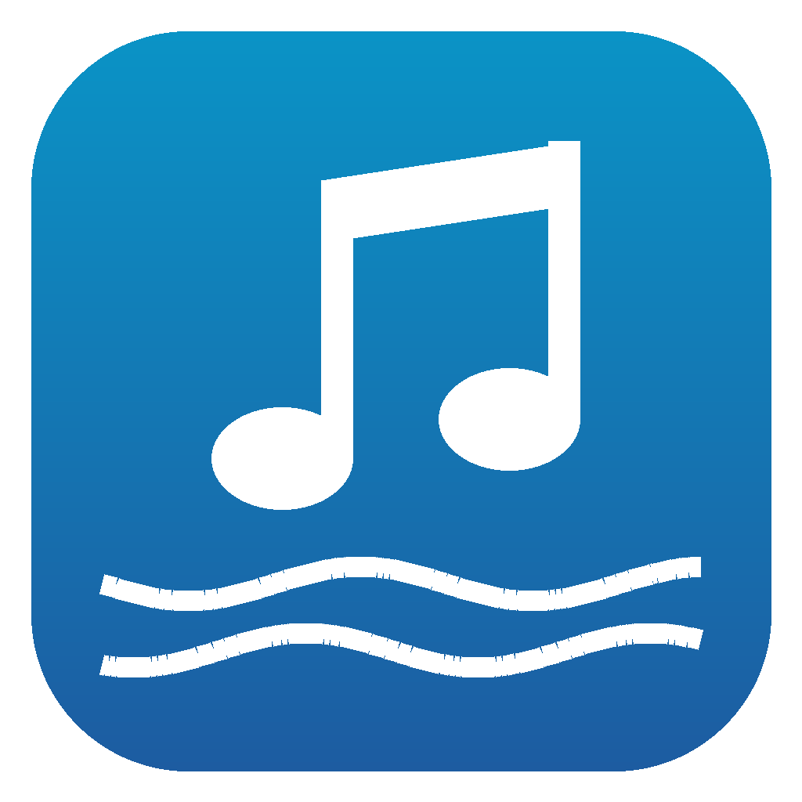</p>

# SwimTunes

Put your music on swimming earphones (Shokz OpenSwim, OpenSwim Pro and similar) the easy way.
Paste a **YouTube** or **Spotify** link, see the songs with their **genre, style, tempo and country**,
choose which folder each one goes into, and download them as MP3s. Songs you already have are skipped,
and SwimTunes keeps your earphones in sync, including the folders you made before you had SwimTunes.

Everything happens in a simple page in your web browser, in **English, French, Spanish, German, Italian or
Portuguese** (your computer's language is picked automatically, and you can switch at the bottom of the page).
No commands to type.


## Download

| Your computer | Download |
|---|---|
| **Windows** | [SwimTunes-Windows.exe](https://github.com/jumalley/swimtunes/releases/latest/download/SwimTunes-Windows.exe) |
| **Mac** with Apple chip (M1, M2, M3, M4…) | [SwimTunes-Mac-AppleSilicon.zip](https://github.com/jumalley/swimtunes/releases/latest/download/SwimTunes-Mac-AppleSilicon.zip) |
| **Mac** with Intel processor (older Macs) | [SwimTunes-Mac-Intel.zip](https://github.com/jumalley/swimtunes/releases/latest/download/SwimTunes-Mac-Intel.zip) |

Not sure which Mac you have? Click the Apple menu  → **About This Mac**. It says **Chip: Apple M…** or **Processor: Intel**.

Nothing else to install. SwimTunes includes everything it needs.

### First start on Windows

1. Double-click **SwimTunes-Windows.exe**. (Tip: put it in a folder like *Documents\SwimTunes* first.)
2. Windows may say **"Windows protected your PC"**. Click **More info**, then **Run anyway**.
   This only happens the first time, because SwimTunes is a free app that isn't registered with Microsoft.
3. A black window opens, and then SwimTunes opens in your web browser.
   **Leave the black window open** while you use SwimTunes. Close it (or click **Quit**) when you're done.
4. Optional: in **Settings**, click **Put a SwimTunes icon on my desktop**.

### First start on Mac

1. Double-click the downloaded **.zip** file. A **SwimTunes** app appears. Drag it into your **Applications** folder.
2. Double-click **SwimTunes**. The first time, your Mac says it *can't check the app for malicious software*.
   Click **Done** (or **OK**).
3. Open **System Settings → Privacy & Security**, scroll down, and click **Open Anyway** next to
   *"SwimTunes was blocked"*. Enter your password if asked. This only happens the first time.
4. SwimTunes opens in your web browser. To stop it, click **Quit** at the top right of the page.

### Updates

When a new version is out, a banner appears at the top of the page and the status bar at the bottom says
*Update available*. Click **Update now**: SwimTunes downloads the new version, restarts, and the page
reloads by itself. You can also check in **Settings → Updates**.

## How to use it

### 1. Bring in the songs already on your earphones

Connect the earphones with their charging cable and open the **Earphones** tab. SwimTunes finds them,
shows each folder on them (and the songs lying outside any folder) and whether SwimTunes has it.
Click **Import** to copy those songs into SwimTunes, keeping your folders and their play order; songs in
sub-folders are included. A live report shows each song: imported, already in SwimTunes (and where), or failed.
Songs that exist only on the earphones are **never** deleted.

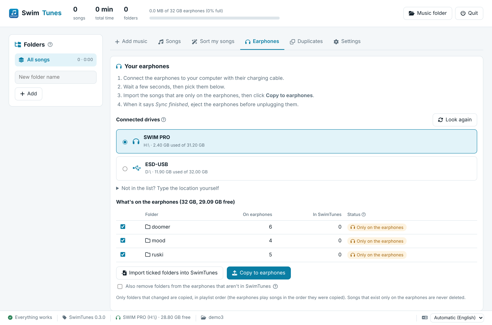

### 2. Let SwimTunes learn how you sort your music

Click **Edit my rules → Learn from my folders**. SwimTunes looks up every song, shows you live what it
finds, and works out what each of your folders has in common: a style, a country, Cyrillic titles…
You can edit the rules or write your own.

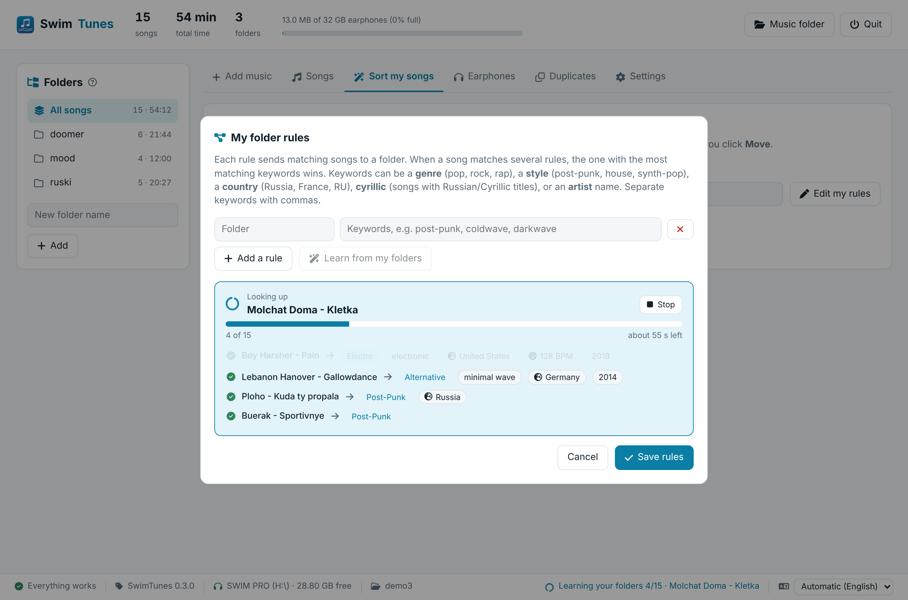

### 3. Add music

In **Add music**, paste YouTube or Spotify links (**Share → Copy link**) and click **Find songs**.
Nothing is downloaded yet. The list appears right away and fills in live: you see which song is being
looked up, what was found (genre, style, country, year, tempo), how long is left, and you can **Stop** at any time.
Songs you already have are left out.


Then pick how to sort them:

| Sort the songs | Example folders |
|---|---|
| **My folder rules** | doomer, mood, ruski… (the best-matching rule wins) |
| **By genre** | Pop, Rock, Rap & Hip Hop, Electro |
| **By style** | Post-Punk, House, Synth-Pop, Coldwave |
| **By swim tempo** | Easy (under 100 BPM), Steady, Fast, Sprint (140+ BPM) |
| **By decade** | 1980s, 1990s, 2000s |
| **By artist's country** | Russia, France, USA |
| **By artist** | one folder per artist |
| **All in one folder** | the playlist's name, or any folder you type |

You can change the folder of any song, untick songs you don't want, then click **Download**. Three songs
are downloaded at the same time (and still saved in playlist order). Each song shows what's happening:
finding it on YouTube, downloading (with %), converting to MP3, measuring the tempo, saved. Album covers
(from Deezer, or the YouTube thumbnail) are shown in the list and saved inside the MP3s.

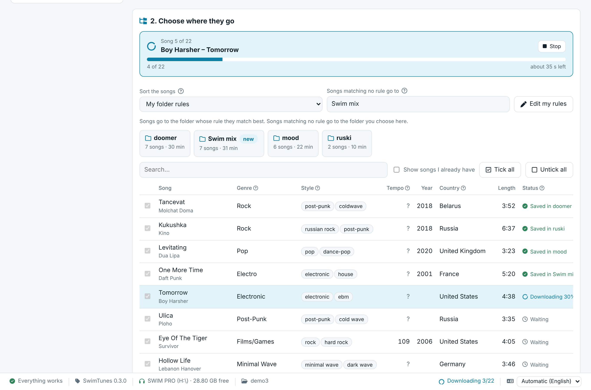

Tempo comes from Deezer when it knows it. Otherwise SwimTunes measures it from the audio after downloading.

### Private playlists: connect your accounts

In **Settings → Accounts** you can connect your accounts. Then **My playlists** (next to *Find songs*) lists your own
playlists, private ones included, plus your Liked songs/videos. Your logins stay on your computer
(in a private file in your home folder, never in the music folder).

- **YouTube**: YouTube doesn't let apps log in directly, so SwimTunes uses the YouTube login of a web browser on your
  computer. Sign in to YouTube in that browser, pick it in SwimTunes, click **Test**. **Firefox works best**: on Windows,
  Chrome and Edge lock their logins so other apps can't use them; with those, export a `cookies.txt` file instead
  (the panel explains how). Being connected also helps with age-restricted videos and your own private videos.
- **Spotify**: Spotify needs a free *Client ID* for each app, created once in 2 minutes on the
  [Spotify developer dashboard](https://developer.spotify.com/dashboard): create an app, tick *Web API*, use the
  *Redirect URI* shown in SwimTunes, paste the Client ID and click **Connect Spotify**. Connected, Spotify playlists have
  no 100-song limit, private playlists work, and album covers come from Spotify.

### Your playlists at a glance

**Songs** opens on your playlists as cards: one card per folder, the same folders as on the earphones.
Each card shows how long the playlist plays, **how many swims it lasts** (pick how long one swim is: 30 min,
45 min, 1 h…), when songs were last added or removed, and whether the earphones have the latest version.

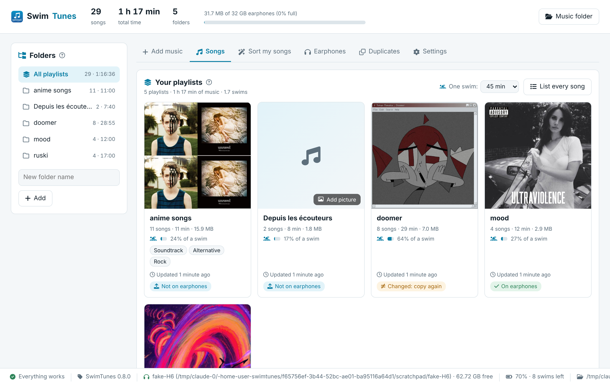

Click **Add picture** to give a playlist a picture: drop or paste your own, use one of its songs' album covers,
make a mosaic of them, or pick from albums, playlists and artists suggested from the songs (artists, genres,
folder name). The picture stays in SwimTunes; the earphones have no screen. Click a card to see its songs.

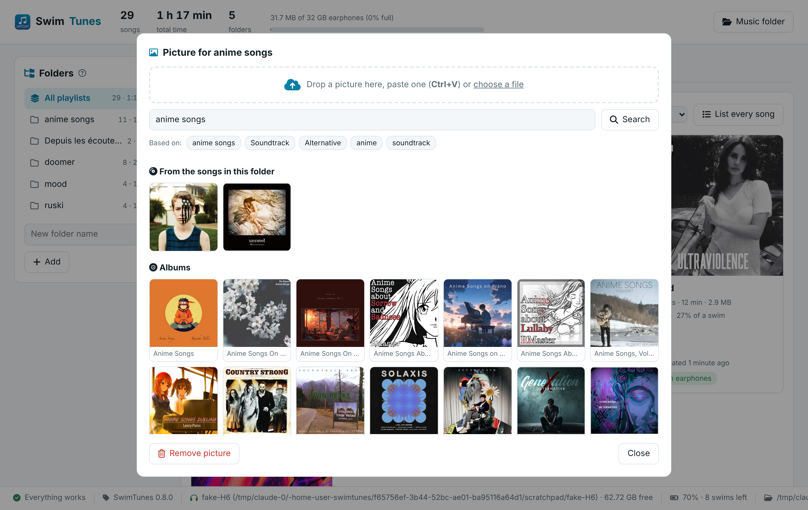

### Battery and firmware (Bluetooth)

In **Earphones → Battery and settings**, click **Read from the earphones** to see the battery level (and how
many swims it has left), the firmware version, whether they play MP3 or Bluetooth, the shuffle/repeat setting and the
sound mode. If they're on **shuffle**, SwimTunes warns you: your playlist order is then ignored.

This uses the same Bluetooth protocol as the free [Gadgetbridge](https://gadgetbridge.org/gadgets/headphones/shokz/)
app (OpenSwim Pro supported). Pair the earphones once with your computer in its Bluetooth settings, switch them on and
take them out of the charger. Works on Windows and Linux; on a Mac only what macOS itself knows can be shown.
Reading doesn't change anything on the earphones.

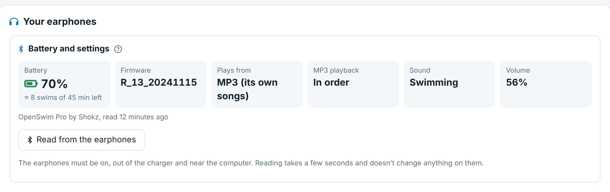

### 4. Sort the songs you already have

**Sort my songs** uses the same sorting options on songs that are already in SwimTunes. It shows where
each song would go, and nothing moves until you click **Move**.

### 5. Copy to your earphones

Back in **Earphones**, click **Copy to earphones**. Only folders that changed are copied, in playlist order
(the earphones play songs in the order they were copied). When it says *Sync finished*, eject the earphones.

### Help is built in

Every option and column has a **?** that explains it, and the status bar at the bottom always shows
whether everything works, your version, whether your earphones are connected, what SwimTunes is busy with,
and the language.

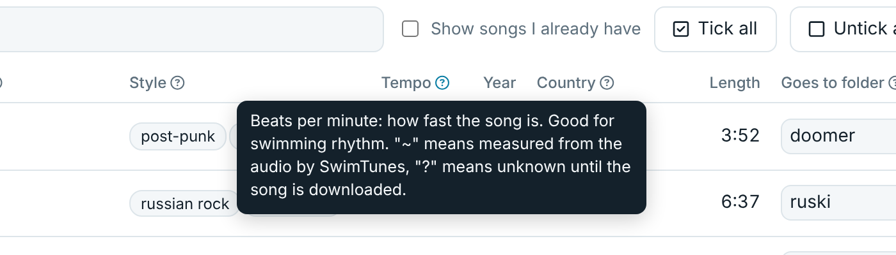

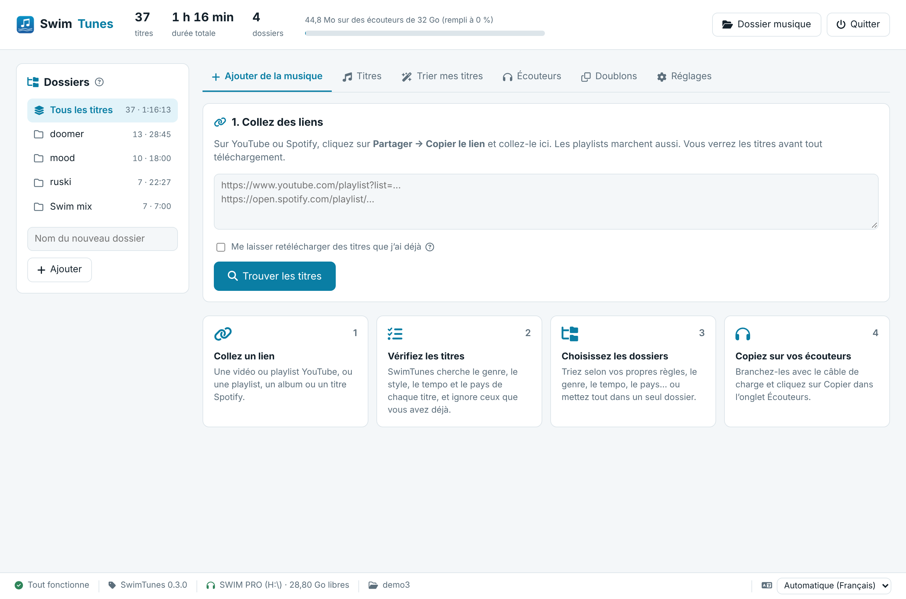

<p>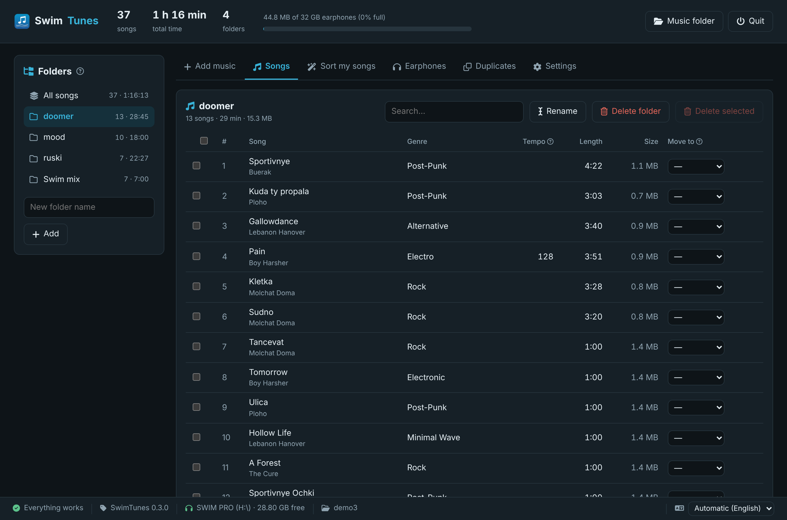 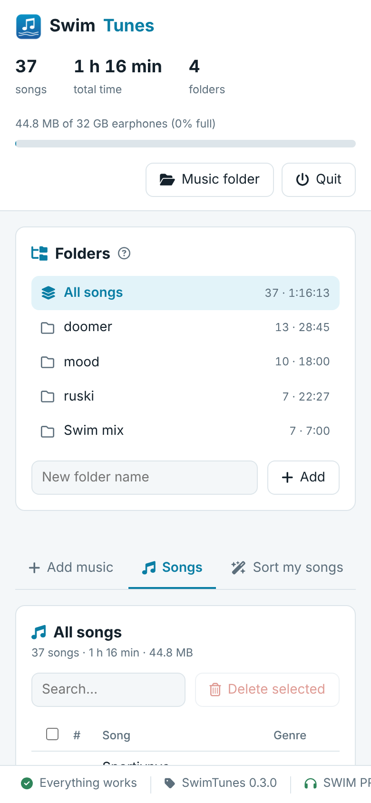</p>

> Screenshots use sample data: the songs are silent demo files, downloads and the Bluetooth reading are simulated,
> but genre, style, country and picture suggestions come from the real Deezer and MusicBrainz databases.

## Questions

**Where are my MP3s?** In the **Music** folder of your computer, inside **SwimTunes**. Click **Music folder** at the top of the page.

**Downloads stopped working.** YouTube changes things now and then. Update SwimTunes (banner at the top, or
Settings → Updates). New versions are built automatically every month.

**Where does the genre information come from?** From [Deezer](https://www.deezer.com) (genre, tempo, year) and
[MusicBrainz](https://musicbrainz.org) (styles, country). Both are free and need no account. Lookups are saved,
so each song is looked up only once.

**A song has wrong or missing genre info.** Music databases don't know every song (soundtracks, fan uploads…).
SwimTunes then guesses from the title, channel and YouTube tags (soundtrack, anime, nightcore, lo-fi…), marked with a
small wand. Click the **pencil** next to a song to correct its artist or title and look it up again.

**Some downloads failed.** Hover the red label to see why. When YouTube refuses a download, SwimTunes already
tries other ways automatically; click **Retry failed songs** a bit later, it usually works. Age-restricted or
region-blocked videos can't be downloaded: try another upload of the same song.

**"Already there" when downloading.** SwimTunes found that you already have this song (the tooltip says in which
folder), so it isn't downloaded twice.

**Some songs say "Unavailable on YouTube".** The video is private or was deleted. It's unticked and skipped.

**My Spotify playlist only shows about 100 songs.** Without a connected account, Spotify only shows the first ~100 songs.
Connect your Spotify account (Settings → Accounts) to get them all.

**"YouTube won't show this playlist".** It's private (or the link is incomplete). If it's yours, connect your YouTube account.

**"Couldn't connect to the earphones over Bluetooth".** Check they're paired with this computer (its Bluetooth
settings), switched on, out of the charging cradle and close by. If your phone is connected to them at the same time,
it can help to turn the phone's Bluetooth off for a moment.

**Does the playlist picture go on the earphones?** No, they have no screen. It's saved as a hidden
`.swimtunes-cover.jpg` in the folder and is never copied to the earphones.

**It says the earphones aren't found.** Connect them to the computer with the charging cable (not to a wall plug),
wait 10 seconds and click **Look again**. On Windows they appear in **This PC** (e.g. *SWIM PRO (H:)*).

**Is this allowed?** Only download music you're allowed to: your own uploads, free music, or what the law where you live allows for personal use.

**Credits.** Icons: [Font Awesome Free](https://fontawesome.com) (CC BY 4.0 / SIL OFL / MIT), bundled in `swimtunes/static/fa`.

---

## For developers

### Running from source

```bash
git clone https://github.com/jumalley/swimtunes.git
cd swimtunes
pip install -e .
python -m swimtunes ui
```

A copy made with `git clone` updates itself from the dashboard too (it runs `git pull`, installs new
requirements if needed and restarts). ffmpeg and Deno (needed for YouTube) are installed from PyPI.

### Command line

Everything is in the dashboard, but a command line exists for scripting:

```bash
swimtunes download "https://www.youtube.com/playlist?list=..." -f "Morning Swim"
swimtunes stats [FOLDER]          # folders / songs with length and size
swimtunes dupes [--fix]           # list duplicates / move extra copies to the trash
swimtunes sync H:\                # copy to the earphones (never deletes songs only on them)
swimtunes doctor                  # check ffmpeg, deno and yt-dlp
```

Use `python -m swimtunes ...` if the `swimtunes` command isn't found. The music folder is `~/Music/SwimTunes`
(change it with `--library` or the `SWIMTUNES_LIBRARY` environment variable).

### How it's organized

| file | what it does |
|---|---|
| `swimtunes/downloader.py` | find songs behind a link (yt-dlp, Spotify embed page), download + convert to MP3 |
| `swimtunes/meta.py` | genre/tempo/year (Deezer), styles/country (MusicBrainz), tempo measurement |
| `swimtunes/sorter.py` | sorting modes, folder rules, learning rules from existing folders |
| `swimtunes/library.py` | the music folder: tags, stats, duplicates, trash |
| `swimtunes/device.py` | find the earphones, compare, import, sync in play order |
| `swimtunes/shokz.py` | battery / firmware / settings over Bluetooth (RFCOMM, Shokz protocol from Gadgetbridge) |
| `swimtunes/covers.py` | album covers for songs, playlist pictures and picture suggestions |
| `swimtunes/updater.py` | in-app updates (release download or git pull) |
| `swimtunes/web.py` | the dashboard's server: jobs with live progress, status bar, translatable messages |
| `templates/index.html`, `static/app.js`, `static/app.css` | the dashboard page |
| `static/i18n.js` | translations (en, fr, es, de, it, pt); server messages carry keys from `swimtunes/i18n.py` |

### How the apps are built

[`.github/workflows/build-apps.yml`](.github/workflows/build-apps.yml) runs the tests, builds the
Windows and Mac apps with PyInstaller ([`packaging/swimtunes.spec`](packaging/swimtunes.spec)), checks
each one with `doctor`, and publishes them as a GitHub release. It runs on every code change and once a month,
so the apps always include a recent yt-dlp.

### Tests

```bash
pip install -e ".[test]" && pytest
```
